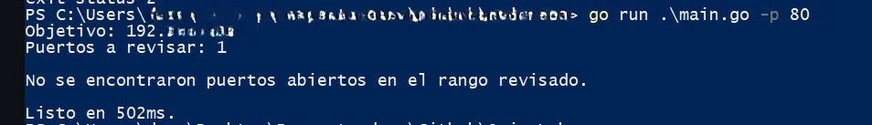
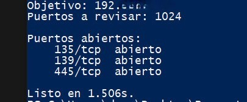

OrionScan es un escáner de puertos TCP escrito en Go. Lo desarrollé para tener una herramienta rápida, liviana y fácil de distribuir: se compila a un único archivo `.exe` que no necesita Python, Node ni otras instalaciones.

Por defecto revisa la IP de la red local de la máquina donde se ejecuta, así que cualquiera puede ver qué puertos de su propio equipo están accesibles desde la red.

Código fuente: [github.com/imdraz/OrionScan](https://github.com/imdraz/OrionScan)

## Qué hace

- Detecta automáticamente la IP de tu red local, o usa la que indiques con `-host`.
- Acepta listas (`22,80,443`) y rangos (`1-1024`) de puertos.
- Revisa los puertos en paralelo con goroutines. La cantidad de conexiones simultáneas se configura con `-w`.
- Muestra solo los puertos que aceptan conexiones y el tiempo total del escaneo.
- Usa TCP connect, así que no necesita permisos de administrador ni drivers adicionales.

## Uso

```powershell
.\OrionScan.exe                          # revisa tu red local, puertos 1-1024
.\OrionScan.exe -p 80                    # revisa solo el puerto 80
.\OrionScan.exe -p 22,80,443,3389,8080   # revisa una lista de puertos
.\OrionScan.exe -host 192.168.1.1 -p 1-65535 -w 1000
```

Las opciones principales son:

| Opción     | Función                             | Valor por defecto |
|---         |    ---                              |      ---                |
| `-host`    | Equipo a revisar                    | IP de tu red local |
| `-p`       | Puertos: lista o rango              | `1-1024` |
| `-t`       | Tiempo máximo de espera por puerto  | `500ms` |
| `-w`       | Conexiones simultáneas              | `500` |

## Ejemplos de ejecución

Primero, un escaneo de un solo puerto. Si no responde, el programa lo informa sin mostrar resultados falsos:



Después, un escaneo de los 1024 puertos por defecto. En este caso aparecen tres puertos abiertos:



## Cómo interpretar el resultado

Un puerto aparece como **abierto** cuando el equipo acepta una conexión TCP en ese puerto. Eso indica que hay un servicio escuchando, pero no dice qué servicio es ni si está bien configurado.

En el ejemplo anterior aparecen los puertos típicos de un equipo Windows con el uso compartido de archivos activado:

- **135/tcp**: servicio RPC de Windows.
- **139/tcp**: NetBIOS sobre TCP, usado para compartir archivos e impresoras en redes antiguas.
- **445/tcp**: SMB, el protocolo de uso compartido de archivos.

Que estén abiertos no significa que el equipo esté comprometido. Sí conviene revisar si realmente necesitás esos servicios y, si no, desactivarlos o restringir el acceso desde el firewall.

Un puerto que no aparece puede estar cerrado o filtrado por un firewall. OrionScan no distingue entre ambos casos.

## Limitaciones

- Solo detecta puertos TCP. No hace escaneo UDP ni escaneo SYN.
- No identifica el servicio que corre en cada puerto ni su versión.
- Un timeout muy corto (`-t`) puede omitir servicios con respuesta lenta.

## Uso responsable

OrionScan está pensado para que sea ejecutado desde el equipo personal o laboral que utilices.

## Descarga

El ejecutable precompilado para Windows está disponible en la sección [Releases](https://github.com/imdraz/OrionScan/releases) del repositorio.
